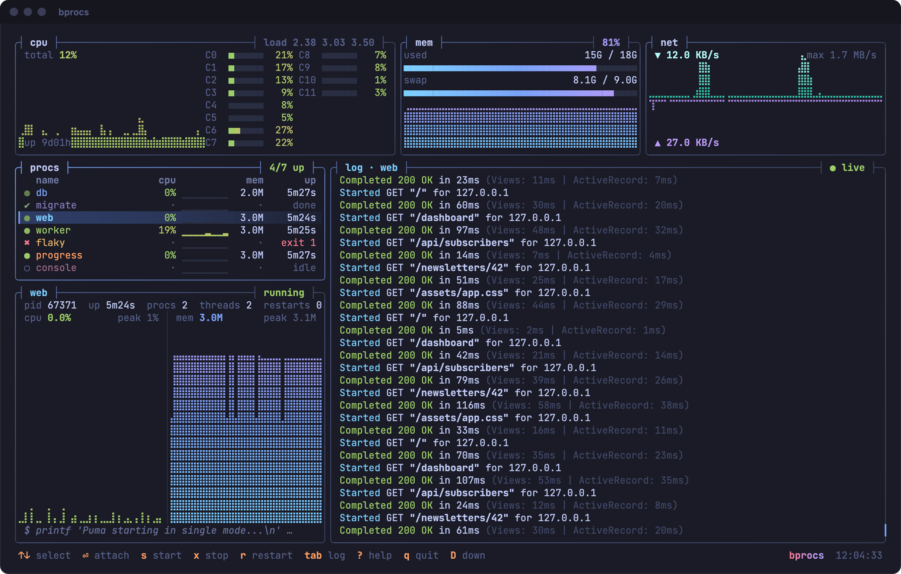

# bprocs

A process manager for the terminal that draws like btop: run a project's servers, workers and tools side by side, watch their output, CPU and memory, and start, stop, restart or type into any of them.

The processes run in a daemon of their own, one for each project, so quitting the TUI leaves them running, the way Docker keeps containers under lazydocker. `bprocs` opens the TUI on them again, and `bprocs down` stops them. The same daemon serves a CLI for scripts, and `bprocs run` runs everything in the foreground for CI.

It reads a `bprocs.yml`, and a `Procfile` works as it does with foreman.



## Features

- **btop-style rendering.** bprocs draws every frame into a cell grid and writes only the cells that changed, in true colour or the 256-colour palette, inside a synchronized update so frames never tear.
- **System view.** Shows CPU per core in gradient meters, a braille graph of total CPU, memory and swap meters, and network graphs.
- **Process list.** Each process gets a status that pulses while it runs, a spinner while it starts or stops, and a red flash when it crashes. The list also shows its port, CPU with a sparkline, memory and uptime.
- **Details of the selected process.** Shows its pid, child processes, threads, restarts, what it needs, the last failed check, and CPU and memory graphs for the whole process group.
- **Logs with colour.** Programs run on a pseudo-terminal of their own, so they keep their colours. Carriage-return progress bars rewrite their line, long lines wrap, and the scrollback is kept. `/` searches, `&` shows only the lines found, `a` shows every process's lines together, and `log:` also writes them to a file.
- **Attach.** Enter types into the selected process, for a REPL or a `byebug` prompt; ctrl-a detaches. `bprocs attach NAME` does the same on a plain terminal.
- **Startup order.** `needs:` starts a process once what it needs is up: a service once it is ready, a job once it exited with 0. A process whose needs fail is blocked, and says why. A down stops what needs a process before the process.
- **Checks.** `ready:` holds a process in *starting* until a line of its output, a port, an HTTP endpoint or a command says it is up. `health:` keeps checking while it runs.
- **Restarts.** `restart: on-failure` or `always` starts it again with a growing pause, after a crash, a start that was not ready in time, or a failed health check, and gives up after ten quick failures in a row.
- **A daemon per project.** The TUI, the CLI and `bprocs run` talk to it over a Unix socket only its user can open. `bprocs ls` and `p` in the TUI list every project that runs on the machine.
- **Themes.** tokyo-night, dracula, nord, gruvbox and catppuccin; `t` cycles through them. Each theme also recolours the programs' own 16 colours.
- **Small terminals.** `1` to `4` hide the cpu, memory, network and details boxes, as in btop, and give their room to the list and the log. The TUI remembers them in [your own config](#your-own-settings). The layout also drops the system boxes and then the details as the terminal shrinks; the mouse selects and scrolls.

## Usage

```sh
cc tools/build.c -o nob     # once
./nob release
./out/release/bprocs        # the TUI, starting the daemon first when none runs
```

The config is found in the current directory or the nearest one above it: `bprocs.yml`, `bprocs.yaml`, `Procfile.dev` or `Procfile`, in that order. The `bprocs.yml` in this directory is a demo of harmless processes.

| Command | |
|---|---|
| `bprocs` | open the TUI; starts the daemon and the autostart procs when none runs |
| `bprocs up [NAME…]` | start the daemon and the autostart procs, or the named ones, and return |
| `bprocs down` | stop every proc, the ones that need others first, then the daemon |
| `bprocs start\|stop\|restart\|kill NAME…` | one or more procs; starting one starts what it needs |
| `bprocs ps [--json] [--fail]` | state, health, pid, port, CPU, memory, uptime and restarts; `--fail` exits with 1 when a proc failed with no restart coming |
| `bprocs logs NAME [-n N] [-f]` | a proc's output, the last N lines, followed with `-f` |
| `bprocs attach NAME` | type into a proc on this terminal; ctrl-a d detaches |
| `bprocs wait NAME… [--timeout 2m]` | until each is up, or a job has succeeded |
| `bprocs reload` | read the config again: restart only the procs that changed, start new ones, stop gone ones; `SIGHUP` to the daemon does the same |
| `bprocs ls` | every running daemon on this machine |
| `bprocs run [NAME…] [--wait NAME] [--exit-on-failure] [--ready-timeout D] [--plain]` | run in the foreground, without a daemon, for CI |

A `NAME` for `up`, `start`, `stop`, `restart`, `kill`, `wait` and `run` can also be an app of [`include:`](#apps-with-their-own-config), for every proc of it.

Options before the command: `-C DIR` looks for the config from `DIR`, `-f FILE` uses that config, and `--theme NAME`, `--256` and `--truecolor` set how the TUI looks. Durations are written as `500ms`, `30s` or `2m`.

The exit status is 0 on success, 1 when a proc failed or a wait timed out, 2 for a usage or config error, and 3 when a command needs a daemon and none runs. `bprocs down` with nothing running is 0.

### CI

`bprocs run` starts the autostart procs, or the named ones and what they need, in the foreground and prints every line with the proc's name in front:

```sh
bprocs run tests --wait tests --ready-timeout 3m
```

With `--wait`, it stops everything once that proc ends and exits with its exit status. `--exit-on-failure` stops everything, with 1, once any proc fails with no restart coming, and `--ready-timeout` does when the procs are not all up in time. Without them, it runs until every proc has ended, or until `SIGINT` or `SIGTERM`. It still serves the project's socket, so another step can run `bprocs ps` or `bprocs wait web`.

### Keys

| Keys | |
|---|---|
| `↑` `↓` `j` `k` | select a row, or scroll the log when it has the focus |
| `enter` `i` / `ctrl-a` | attach to the process and type into it / detach |
| `h` `l`, `←` `→`, `enter` | hide or show the processes of an app of `include:` |
| `tab` | move the focus between the list and the log |
| `s` `x` `r` `K` | start, stop, restart, kill |
| `S` `X` | start all, stop all |
| `pgup` `pgdn` `g` `G` `f` | scroll the log, oldest, newest, follow on or off |
| `/` `n` `N` `&` | search the log, next older match, next newer, only the lines found |
| `a` | the lines of every process together |
| `c` | clear the log |
| `o` | open `http://localhost:<port>` |
| `p` | switch to another running project |
| `R` | reload the config; the TUI says when the file changed |
| `1` `2` `3` `4` | hide or show the cpu, mem, net and details boxes, as in btop; kept in [your own config](#your-own-settings) |
| `t` | next theme |
| `?` | help |
| `q` | quit, leaving everything running |
| `D` | down: stop everything, then quit; `D` again kills them |

`SIGTERM` or `SIGINT` from outside quits the same way as `q`.

## Configuration

The simplest config is a `Procfile`, read as foreman reads one:

```
web: bin/rails server -p $PORT
worker: bundle exec sidekiq
```

A `bprocs.yml` names each proc and what it runs; every other setting is optional:

```yaml
procs:
  web:
    run: bin/rails server
    port: 3000
  worker:
    run: bundle exec sidekiq
```

A web app with a database, with most settings:

```yaml
theme: tokyo-night       # optional
scrollback: 10000        # lines kept per process, optional
env_file: .env           # read for every proc, before env:
env: { RAILS_ENV: development }
log_dir: log/bprocs      # where log: true writes; this is the default

procs:
  db:
    run: postgres -D .data/db
    port: 5432
    ready: { port: 5432 }

  migrate:
    run: bin/rails db:migrate
    job: true                         # runs to the end; what needs it waits for exit 0
    needs: [db]

  web:
    run: bin/rails server             # text runs in /bin/sh -c; a list runs as it is
    cwd: app                          # relative to this file; default: its directory
    port: 3000                        # sets $PORT, and is what checks and o use
    needs: [db, migrate]
    ready: { http: /up, timeout: 60s }
    health: { http: /up, every: 10s }
    restart: on-failure               # no (default), on-failure or always
    stop: { signal: SIGINT, timeout: 10s }
    log: true                         # also write the output to log/bprocs/web.log
    color: "#7aa2f7"                  # the name's colour; default: the theme's

  console:
    run: [bin/rails, console]
    autostart: false
```

| Setting | |
|---|---|
| `run` | what to run: text for `/bin/sh -c`, or a list of words |
| `cwd`, `env`, `env_file` | where and with what; a proc's own `env_file` and `env` come after the top level's, and `null` removes a variable |
| `port` | sets `$PORT`, shows in the list, and is the port checks and `o` use; a port already in use stops the proc from starting |
| `autostart` | started by `bprocs up` and `bprocs`; default `true` |
| `job` | runs to the end; takes no `ready:` and no `restart: always` |
| `needs` | procs that must be up first |
| `ready`, `health` | one of `log: text`, `port: 5432`, `http: /path` or `http: http://host:port/path`, `cmd: …`; with `every` (default `1s` for ready, `10s` for health), `timeout` for ready, and `failures` (default 3) for health |
| `restart` | `no`, `on-failure` or `always` |
| `stop` | `SIGINT`, `SIGTERM`, `SIGHUP`, `SIGQUIT` or `SIGKILL`, or `{ signal, timeout }`; default `SIGTERM` with 5 s before `SIGKILL` |
| `log` | `true` for `log_dir/NAME.log`, or a path; files are appended to and moved to `.1` at 10 MB |
| `color` | the colour of the name |

`examples/` has the configs that the tests load: `minimal`, a typical web app in `medium`, `max`, which uses every setting, a Procfile in `procfile`, and apps with their own config in `include`.

An unknown setting is an error with its line, so a typo does not go unnoticed, and so are a name in `needs` that is not a proc, needs that go round in a loop, and two procs with the same port. Programs see `TERM=xterm-256color` and `COLORTERM=truecolor`.

### Procfile

A `Procfile`, `Procfile.dev` or any other `Procfile.*` is read as foreman reads one:

- Each line is `name: command`. The name is letters, digits, `-` and `_`, and the command runs in `/bin/sh -c`. Blank lines and `#` comments are skipped, and any other line is an error with its line number.
- A `.env` beside the Procfile is read when there is one.
- `PORT` is 3000 for the first proc, 3100 for the next and so on, or starts at the `.env`'s `PORT`, else at the `PORT` bprocs runs with. That is the daemon's, from when it started: a `bprocs reload` does not see a `PORT` changed since. It is not the proc's `port`: bprocs cannot tell whether the program listens on it, so the list shows no port, and a port in use does not stop the proc from starting.
- Every proc gets the defaults above, so it starts with the others, does not restart, and has no checks. For needs, checks, restarts or log files, write a `bprocs.yml`.

### Apps with their own config

`include:` runs apps that each have their own `Procfile` or `bprocs.yml` in one daemon and one list, beside the services they share:

```yaml
env: { RAILS_ENV: development }       # every proc, included ones too, gets this first

include_defaults:                      # what every app starts from, optional
  setup: bin/setup --skip-server
  wrap: [mise, exec, --]

procs:
  db:
    run: postgres -D .data/db
    port: 5432
    ready: { port: 5432 }

include:
  shop:
    dir: shop                          # where its bprocs.yml or Procfile is; default: the name
    port: 3001                         # its Procfile's first PORT
    needs: [db]                        # top-level procs the app needs, optional
    setup: bin/setup --skip-server     # the job shop:setup, which the app's procs need, optional
    env: { RUBY_DEBUG_OPEN: "true" }   # added to every proc of the app, optional
    wrap: [mise, exec, --]             # in front of every command of the app, optional
    autostart: false                   # leaves every proc of the app stopped, optional
```

- An app's procs are named `shop:web`, `shop:worker` and so on, and run in its directory. `bprocs start shop`, and `stop`, `restart` and the others, act on all of them.
- An app's `bprocs.yml` is read instead of its `Procfile`. It is read as any `bprocs.yml`, with paths and `log_dir` relative to the app; its `needs` name its own procs. It takes no `theme`, `scrollback` or `include`, and its include takes no `port:`, as its procs set their own.
- The environment of an app's proc is, later entries winning: the top-level `env_file:` and `env:`, the app's `.env`, for a `bprocs.yml` its own `env_file:` and `env:`, then the proc's `PORT` and its own, then the include's `env:`.
- A `Procfile`'s `PORT`s start at the include's `port:`, else at the `.env`'s `PORT`, else at 3000, and not at the `PORT` bprocs runs with, which every app would share. They are checked against every port of the other apps and the top-level procs: `shop` at 3000 gives its second proc 3100, which another app cannot have.
- `needs:` goes on the setup job when there is one, else on every proc of the app.
- `wrap:` does not wrap `cmd:` checks, and the list shows each command as written.
- An app's setting replaces the one in `include_defaults:`, but its `env:` adds to it.
- `bprocs reload` reads every app's config again, and the TUI notices an edit to any of them or to an `.env`.
- The TUI lists each app under a header, collapsed at first, after the top-level procs. The header shows the app's proc most in need of attention, so a crash shows on a collapsed app, and else how many of its procs are up. Selected, a header shows its procs' lines together, since the TUI opened, and `s`, `x`, `r` and `K` act on all of them.

Run bprocs from the directory of this config, or with `-C ..` from an app's: inside `shop`, bprocs finds `shop`'s own config first and starts a second daemon, whose ports collide with the first's.

### Your own settings

`~/.config/bprocs/config.yml`, or `$XDG_CONFIG_HOME/bprocs/config.yml`, holds your settings for every project. The TUI writes it as you change them, as btop does with its config, and keeps your comments and the rest of the file:

```yaml
boxes: cpu mem net details   # the boxes 1 to 4 hide and show; "" for none
```

An unknown setting or box is an error with its line, as in `bprocs.yml`.

## Profile

| | |
|---|---|
| Language | C23 |
| Compilers | clang 18 or later (primary), gcc 14 or later |
| Platforms | macOS aarch64, Linux x86_64, Linux aarch64 |
| Cross builds | `./nob cross` with [zig](https://ziglang.org) 0.15.2 |
| Profile | Modern C Level 2 |
| Dependencies | [libmc](https://github.com/sangar/libmc), vendored in `deps/libmc` and pinned in `deps.lock` |

Windows is not supported: it has no pseudo-terminals of the POSIX kind, and libmc has no Windows platform layer.

| Command | Result |
|---|---|
| `./nob` | debug build with AddressSanitizer and UBSan: `out/debug/bprocs` |
| `./nob release` | optimised build: `out/release/bprocs` |
| `./nob test` | builds and runs the tests under the sanitizers |
| `./nob check` | runs the `modern-c` contract checker, then the tests |
| `./nob cross` | release binaries for every platform: `out/<platform>/release/bprocs` |
| `./nob install` | optimised build, installed as `$PREFIX/bin/bprocs`; `PREFIX` defaults to `~/.local`, and `DESTDIR` stages it for packaging |
| `./nob uninstall` | removes what `./nob install` placed |
| `./nob clean` | removes `out/` |

## Layout

| File | |
|---|---|
| `src/main.c`, `src/cli.c` | the command line and every command |
| `src/config.c` | `bprocs.yml` and `Procfile` |
| `src/userconfig.c` | your own settings, in `~/.config/bprocs/config.yml` |
| `src/proc.c` | one supervised program: run, read, stop, restart, its log file |
| `src/supervisor.c` | the procs of a config: needs, checks, restart policies, down in order, reload |
| `src/check.c` | port, HTTP and command checks |
| `src/server.c` | the supervisor served on a Unix socket |
| `src/daemon.c`, `src/runner.c` | the daemon, and `bprocs run` in the foreground |
| `src/client.c`, `src/protocol.c` | connecting to a daemon, and its messages |
| `src/app.c` | the TUI: input, the daemon's events, frames |
| `src/ui.c` | drawing every box from the app's state |
| `src/screen.c` | the cell grid and the diffing renderer |
| `src/draw.c` | boxes, meters, braille graphs, sparklines |
| `src/logbuf.c`, `src/logview.c` | terminal output into lines, and lines onto the screen |
| `src/input.c` | keys, mouse and paste from the terminal's bytes |
| `src/stats.c`, `src/layout.c`, `src/theme.c`, `src/color.c` | the rest of the picture |

From libmc come the pseudo-terminals and statistics (`mc/platform/pty.h`, `mc/platform/sysinfo.h`), starting the daemon (`process_spawn_detached`, `file_lock`, `file_try_lock`), the socket's frames and the daemon's outboxes (`mc/platform/frame.h`, `mc/concurrency/outbox.h`, `mc/concurrency/waker.h`), signals (`SignalWatch`), log files (`mc/log/logfile.h`), `.env` files (`mc/encoding/dotenv.h`), and the runtime directory and the search for the config (`dir_runtime`, `file_find_upward`).

The daemon of a config keeps its socket, locks and log in a directory only its user can open: `$XDG_RUNTIME_DIR/bprocs` where that is set, as on most Linux systems, else `bprocs-<uid>` in `$TMPDIR` or `/tmp`. They are named after a hash of the config's path. The daemon holds the lock for as long as it runs, so a second daemon or `bprocs run` for the same config refuses to start. Its log is where to look when it does not start.

## License

MIT, see [LICENSE](LICENSE).

